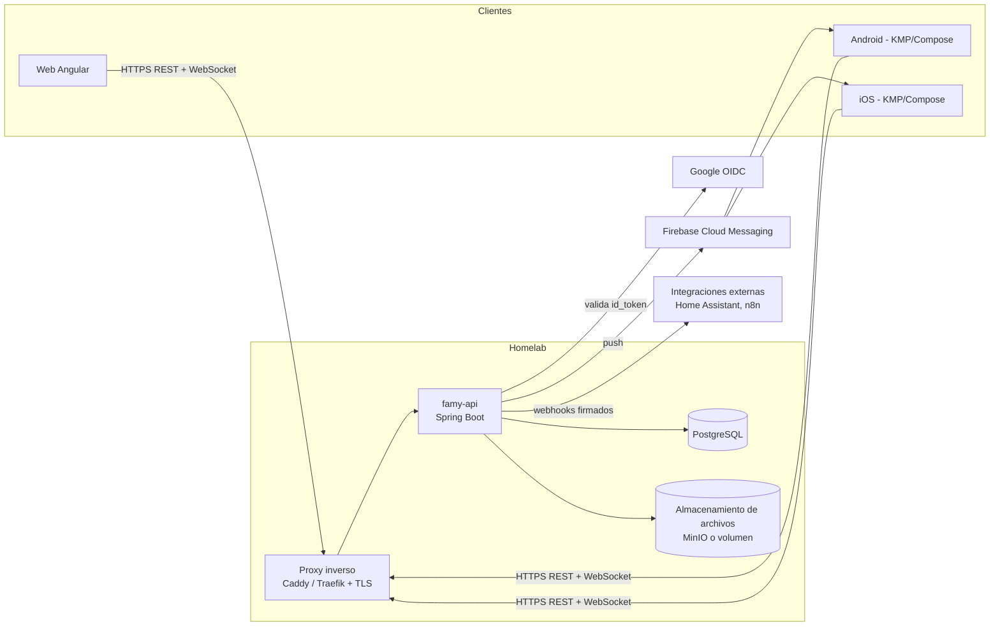
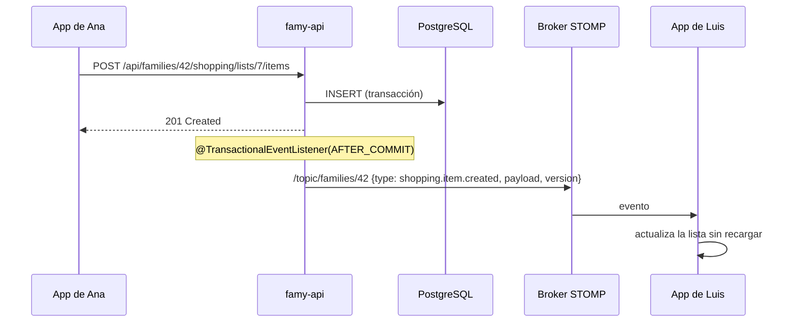

# 04 · Arquitectura

## Vista general



## Backend: monolito modular

Un solo servicio Spring Boot (`famy-api`) organizado por módulos de dominio, con límites claros para poder separar en el futuro si hiciera falta. Para una app familiar autoalojada, microservicios añadirían complejidad sin beneficio.

```
backend/src/main/java/com/famy/
├── shared/        # errores, auditoría, utilidades, configuración
├── identity/      # usuarios, credenciales, Google, JWT, refresh tokens
├── family/        # familias, membresías, invitaciones, roles
├── shopping/      # listas e ítems
├── budget/        # presupuestos, categorías, movimientos
├── recipe/        # recetas e ingredientes
├── calendar/      # eventos, recurrencia, vista unificada
├── chore/         # tareas del hogar y rotación
├── payment/       # calendario de pagos
├── celebration/   # cumpleaños y fechas especiales
├── notification/  # push, recordatorios programados, preferencias
├── realtime/      # WebSocket/STOMP, publicación de eventos de dominio
└── webhook/       # webhooks salientes (post-MVP)
```

Cada módulo: `api` (controladores + DTO), `application` (casos de uso), `domain` (entidades y reglas), `infrastructure` (repositorios JPA). Las dependencias entre módulos se validan con **Spring Modulith** (o ArchUnit).

Librerías principales: Spring Web, Spring Security + OAuth2 Resource Server, Spring Data JPA, Flyway, Spring WebSocket (STOMP), Bean Validation, MapStruct, springdoc-openapi, Bucket4j, Testcontainers.

## Tiempo real

El mensaje original pide "actualizarse con webhooks". Un webhook es una llamada HTTP de servidor a servidor, así que no sirve para avisar a un navegador o a un celular. Se usan tres mecanismos complementarios:

| Mecanismo | Para qué | Cuándo |
|-----------|----------|--------|
| **WebSocket (STOMP)** | Actualizar en vivo las pantallas abiertas (web y app en primer plano) | Siempre que la app está abierta |
| **Push (FCM / APNs)** | Avisar cuando la app está cerrada: recordatorios, "Ana agregó algo" | App en segundo plano |
| **Webhooks salientes** | Integrar Famy con otros sistemas del homelab | Post-MVP, configurable por familia |

Flujo de un cambio:



- Formato del evento: `{ id, type, familyId, entity, entityId, version, actor, occurredAt, payload }`.
- Cada entidad tiene `version` (bloqueo optimista). El cliente ignora eventos con versión menor a la que ya tiene.
- Al reconectar, el cliente pide `GET /api/families/{id}/changes?since=<cursor>` para recuperar lo que se perdió (tabla `change_log`).
- MVP: broker STOMP en memoria de Spring (una sola instancia). Si se escala a varias instancias: relay a RabbitMQ o `LISTEN/NOTIFY` de PostgreSQL.

## Web (Angular)
- Angular con standalone components, signals y lazy loading por módulo.
- Estado: servicios con signals + caché por recurso; el cliente STOMP (`@stomp/rx-stomp`) aplica los eventos al estado.
- Interceptor HTTP para el access token y refresh automático.
- PWA (service worker) para instalación y notificaciones web.

## Móvil (Kotlin Multiplatform)
- **Compose Multiplatform** para UI compartida Android + iOS.
- Módulo `shared`: Ktor Client (REST + WebSocket STOMP), kotlinx.serialization, SQLDelight (caché offline y cola de cambios), Koin (DI), kotlinx-datetime.
- Plataforma: Google Sign-In / Credential Manager, FCM, Keystore / Keychain.
- Patrón: repositorio con fuente local (SQLDelight) como verdad en la UI y sincronización con el servidor.

## Contrato de API
- REST JSON bajo `/api/v1`, documentado con OpenAPI (springdoc). El cliente Angular y el de KMP se pueden generar desde el contrato.
- Errores en formato `application/problem+json` (RFC 9457).
- Paginación por cursor en listas largas (gastos, actividad).

## Estructura del repositorio (monorepo)

```
Famy/
├── backend/          # Spring Boot (Gradle Kotlin DSL o Maven)
├── web/              # Angular
├── mobile/           # Kotlin Multiplatform (androidApp, iosApp, shared)
├── deploy/           # docker-compose, Caddyfile, scripts de backup
├── design/           # exportaciones de Figma/Canva, prototipo
├── docs/             # esta documentación
└── .github/workflows # CI
```

## Decisiones de arquitectura (ADR resumidas)
| # | Decisión | Motivo |
|---|----------|--------|
| D-01 | Monolito modular | Un desarrollador, despliegue simple en homelab |
| D-02 | WebSocket + push en lugar de webhooks para clientes | Los clientes no exponen un endpoint HTTP |
| D-03 | JWT corto + refresh opaco rotado | Revocable y sin estado en cada petición |
| D-04 | Argon2id | Recomendado por OWASP para contraseñas |
| D-05 | Compose Multiplatform | Una sola UI en Kotlin para Android e iOS |
| D-06 | UUID v7 como ids | Ordenables y seguros para exponer en URLs |
