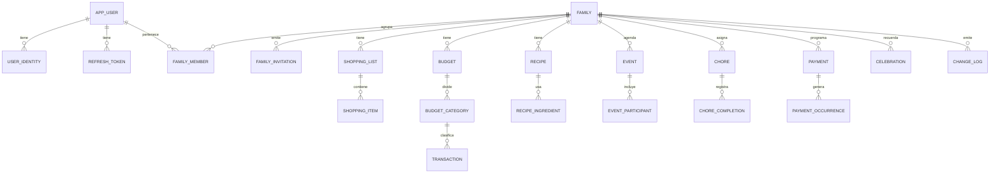

# 05 · Modelo de datos

PostgreSQL 16 con migraciones Flyway. Ids `UUID` (v7). Todas las tablas de dominio tienen `family_id`, `created_by`, `created_at`, `updated_at`, `version` y, donde aplica, `deleted_at`.

## Diagrama ER (núcleo)

## Tablas

### Identidad
| Tabla | Columnas clave |
|-------|----------------|
| `app_user` | id, email (único, citext), email_verified_at, password_hash (nulo si solo Google), display_name, avatar_url, color, birthday, timezone, locale, status, created_at |
| `user_identity` | id, user_id, provider (`GOOGLE`), provider_subject (único por proveedor), email, linked_at |
| `refresh_token` | id, user_id, token_hash, device_name, family_chain_id, expires_at, revoked_at, replaced_by, created_ip |
| `email_token` | id, user_id, purpose (`VERIFY`, `RESET`), token_hash, expires_at, used_at |
| `device` | id, user_id, platform (`ANDROID`, `IOS`, `WEB`), push_token, last_seen_at |

### Familia
| Tabla | Columnas clave |
|-------|----------------|
| `family` | id, name, avatar_url, currency (ISO 4217), timezone, owner_id, created_at |
| `family_member` | family_id, user_id, role (`OWNER`, `ADMIN`, `MEMBER`, `CHILD`), nickname, joined_at, left_at · PK (family_id, user_id) |
| `family_invitation` | id, family_id, code (8 car., único), token_hash (para enlace), role, email (opcional), max_uses, uses, expires_at, revoked_at, created_by |
| `join_request` | id, family_id, user_id, status (`PENDING`, `APPROVED`, `REJECTED`), decided_by, decided_at |

### Compras
| Tabla | Columnas clave |
|-------|----------------|
| `shopping_list` | id, family_id, name, icon, position, archived_at |
| `shopping_item` | id, list_id, family_id, name, quantity, unit, category, note, checked_at, checked_by, position |

### Presupuesto
| Tabla | Columnas clave |
|-------|----------------|
| `budget` | id, family_id, period (`YYYY-MM`), currency · único (family_id, period) |
| `budget_category` | id, budget_id, family_id, name, icon, color, limit_amount |
| `transaction` | id, family_id, category_id, type (`EXPENSE`, `INCOME`), amount NUMERIC(14,2), currency, occurred_on, member_id, note, source (`MANUAL`, `PAYMENT`, `SHOPPING`), source_id |

### Recetas
| Tabla | Columnas clave |
|-------|----------------|
| `recipe` | id, family_id, title, description, photo_url, servings, prep_minutes, cook_minutes, steps (JSONB), tags (text[]) |
| `recipe_ingredient` | id, recipe_id, name, quantity, unit, position |
| `meal_plan_entry` | id, family_id, date, meal (`BREAKFAST`, `LUNCH`, `DINNER`), recipe_id |

### Calendario y horarios
| Tabla | Columnas clave |
|-------|----------------|
| `event` | id, family_id, title, description, location, starts_at, ends_at, all_day, rrule, color, reminder_minutes (int[]) |
| `event_participant` | event_id, user_id |
| `event_exception` | id, event_id, original_start, is_cancelled, override (JSONB) |

### Tareas del hogar
| Tabla | Columnas clave |
|-------|----------------|
| `chore` | id, family_id, title, description, due_at, rrule, points, rotation (boolean), rotation_order (uuid[]), current_assignee_id |
| `chore_completion` | id, chore_id, family_id, completed_by, completed_at, occurrence_date |

### Pagos
| Tabla | Columnas clave |
|-------|----------------|
| `payment` | id, family_id, name, amount, currency, rrule, first_due_on, remind_days_before, responsible_id, budget_category_name |
| `payment_occurrence` | id, payment_id, family_id, due_on, status (`PENDING`, `PAID`, `OVERDUE`), paid_on, paid_by, amount_paid, transaction_id, receipt_file_id |

### Cumpleaños y fechas especiales
| Tabla | Columnas clave |
|-------|----------------|
| `celebration` | id, family_id, type (`BIRTHDAY`, `ANNIVERSARY`, `OTHER`), person_name, user_id (si es miembro), date (mes-día), year (opcional), notes, gift_ideas (JSONB) |

### Transversales
| Tabla | Columnas clave |
|-------|----------------|
| `change_log` | id (bigserial = cursor), family_id, entity, entity_id, op (`C`,`U`,`D`), version, actor_id, occurred_at, payload (JSONB) |
| `notification` | id, user_id, family_id, type, title, body, data (JSONB), read_at, created_at |
| `notification_preference` | user_id, type, push_enabled, quiet_from, quiet_to |
| `scheduled_reminder` | id, family_id, target_type, target_id, fire_at, sent_at |
| `file_object` | id, family_id, storage_key, content_type, size_bytes, sha256, uploaded_by |
| `audit_log` | id, user_id, family_id, action, ip, user_agent, details (JSONB), created_at |
| `webhook_endpoint` (post-MVP) | id, family_id, url, secret_hash, events (text[]), active |
| `webhook_delivery` (post-MVP) | id, endpoint_id, event_id, status, attempts, last_response_code, next_retry_at |

## Índices y reglas
- Índice `(family_id, updated_at)` en todas las tablas de dominio para la sincronización.
- `change_log (family_id, id)` para recuperar cambios desde un cursor; se purga a los 30 días.
- Recurrencias guardadas como RRULE (RFC 5545) y expandidas en el backend con `ical4j` o `lib-recur` para el rango pedido.
- Los recordatorios se calculan al crear / editar y se guardan en `scheduled_reminder`; un job (`@Scheduled` + `SELECT ... FOR UPDATE SKIP LOCKED`) los envía.
