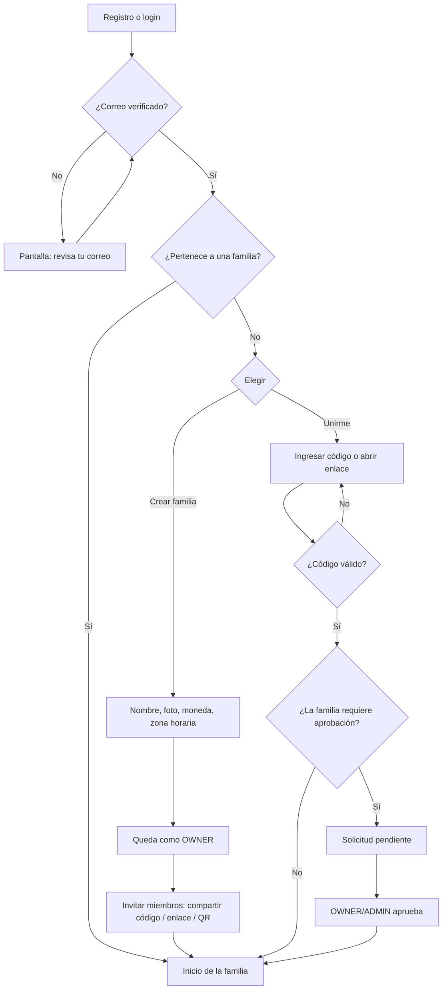

# 06 · Familias: crear y unirse

## Flujo después del registro

## Invitaciones
- **Código**: 8 caracteres en mayúsculas sin ambiguos (sin 0/O, 1/I), p. ej. `FAM-K7QX-2M9P`. Expira en 7 días por defecto, configurable.
- **Enlace**: `https://famy.<dominio>/join/<token>`; abre la app si está instalada (App Links / Universal Links) o la web. El token se guarda como hash.
- **QR**: el mismo enlace en código QR para unirse en persona.
- **Por correo** (opcional): invitación dirigida a un correo; solo ese usuario puede usarla.
- Cada invitación define el rol con que entra la persona (por defecto `MEMBER`), número máximo de usos y si requiere aprobación.
- Unirse tiene rate limiting estricto (5 intentos / 15 min por usuario) para evitar adivinar códigos.

## Roles y permisos

| Acción | OWNER | ADMIN | MEMBER | CHILD |
|--------|:-----:|:-----:|:------:|:-----:|
| Ver todos los módulos | ✓ | ✓ | ✓ | ✓ (sin presupuesto ni pagos, configurable) |
| Agregar / marcar compras | ✓ | ✓ | ✓ | ✓ |
| Crear / editar tareas | ✓ | ✓ | ✓ | Solo marcar las suyas |
| Crear eventos | ✓ | ✓ | ✓ | ✓ (solo propios) |
| Registrar gastos | ✓ | ✓ | ✓ | – |
| Editar presupuesto y pagos | ✓ | ✓ | – | – |
| Invitar miembros | ✓ | ✓ | Configurable | – |
| Aprobar solicitudes / expulsar | ✓ | ✓ | – | – |
| Cambiar roles | ✓ | Solo a MEMBER/CHILD | – | – |
| Editar o eliminar la familia | ✓ | – | – | – |
| Transferir propiedad | ✓ | – | – | – |

## Reglas
- Una familia siempre tiene exactamente un `OWNER`. Si el owner quiere salir, primero transfiere la propiedad.
- Al expulsar a alguien se revocan sus suscripciones WebSocket a esa familia y se le notifica.
- Al salir, los datos que creó se quedan en la familia (se muestra como "ex miembro").
- MVP: un usuario pertenece a una sola familia activa. El modelo (`family_member`) ya permite varias para el futuro (p. ej. hijos de padres separados).

## Endpoints

| Método | Ruta | Descripción |
|--------|------|-------------|
| POST | `/api/v1/families` | Crear familia |
| GET | `/api/v1/families/me` | Familia(s) del usuario |
| POST | `/api/v1/families/{id}/invitations` | Crear invitación |
| DELETE | `/api/v1/families/{id}/invitations/{invId}` | Revocar invitación |
| GET | `/api/v1/invitations/{codeOrToken}` | Vista previa (nombre y foto de la familia) |
| POST | `/api/v1/invitations/{codeOrToken}/accept` | Unirse |
| GET/POST | `/api/v1/families/{id}/join-requests` | Ver / aprobar / rechazar solicitudes |
| PATCH | `/api/v1/families/{id}/members/{userId}` | Cambiar rol |
| DELETE | `/api/v1/families/{id}/members/{userId}` | Expulsar o salir |
| POST | `/api/v1/families/{id}/transfer-ownership` | Transferir propiedad |
