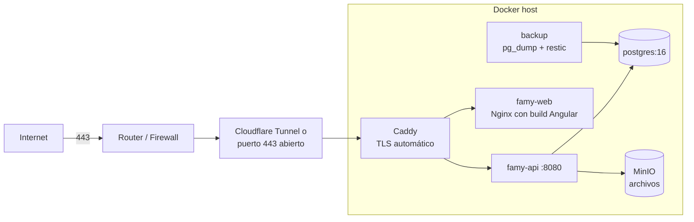

# 07 · Despliegue en homelab

## Topología



Recomendación: exponer con **Cloudflare Tunnel** (o Tailscale Funnel) para no abrir puertos del router y obtener HTTPS. Si se prefiere abrir el 443, Caddy obtiene el certificado de Let's Encrypt automáticamente. El acceso a la app móvil desde fuera de casa requiere uno de estos dos.

## Servicios (docker-compose)

| Servicio | Imagen | Notas |
|----------|--------|-------|
| `caddy` | `caddy:2` | Proxy inverso, TLS, HSTS, compresión; rutas `/api` y `/ws` a la API, el resto a la web |
| `famy-api` | `ghcr.io/jzavala3084/famy-api` | Java 21, usuario no root, healthcheck en `/actuator/health` |
| `famy-web` | `ghcr.io/jzavala3084/famy-web` | Nginx sin privilegios (puerto 8080) sirviendo el build de Angular; genera `/config.json` desde variables de entorno ([web/README.md](../web/README.md)) |
| `postgres` | `postgres:16-alpine` | Volumen persistente, sin puerto expuesto al host |
| `minio` | `minio/minio` | Fotos de recetas, comprobantes, avatares (opcional: volumen local en MVP) |
| `backup` | `restic` + script | `pg_dump` diario, retención 7 diarios / 4 semanales / 6 mensuales, copia fuera del homelab (B2, otro disco o NAS) cifrada |

Esquema mínimo:

```yaml
services:
  postgres:
    image: postgres:16-alpine
    environment:
      POSTGRES_DB: famy
      POSTGRES_USER: famy
      POSTGRES_PASSWORD_FILE: /run/secrets/db_password
    volumes: [pgdata:/var/lib/postgresql/data]
    secrets: [db_password]
    restart: unless-stopped
  famy-api:
    image: ghcr.io/jzavala3084/famy-api:latest
    env_file: .env
    depends_on: [postgres]
    restart: unless-stopped
  famy-web:
    image: ghcr.io/jzavala3084/famy-web:latest
    environment:
      GOOGLE_CLIENT_ID_WEB: ${GOOGLE_CLIENT_ID_WEB}   # vacío = sin botón de Google
    restart: unless-stopped
  caddy:
    image: caddy:2
    ports: ["443:443", "80:80"]
    volumes: [./Caddyfile:/etc/caddy/Caddyfile, caddy_data:/data]
    restart: unless-stopped
volumes: { pgdata: {}, caddy_data: {} }
secrets: { db_password: { file: ./secrets/db_password.txt } }
```

## Variables de entorno (`.env.example`, sin valores reales)
`SPRING_PROFILES_ACTIVE=prod`, `SPRING_DATASOURCE_URL`, `SPRING_DATASOURCE_USERNAME`, `DB_PASSWORD`, `JWT_PRIVATE_KEY_FILE` (PEM PKCS#8 EC P-256), `GOOGLE_CLIENT_ID_WEB`, `GOOGLE_CLIENT_ID_ANDROID`, `GOOGLE_CLIENT_ID_IOS`, `FCM_CREDENTIALS_FILE`, `MAIL_HOST`, `MAIL_PORT`, `MAIL_USERNAME`, `MAIL_PASSWORD`, `MAIL_FROM`, `APP_BASE_URL`, `CORS_ALLOWED_ORIGINS`. Plantilla en [`deploy/.env.example`](../deploy/.env.example); entorno local en `deploy/docker-compose.dev.yml`.

## Correo
Para verificación y recuperación se necesita SMTP: un servicio transaccional (Resend, Brevo, Amazon SES) o Gmail con contraseña de aplicación al inicio.

## CI/CD (GitHub Actions)
1. En cada PR: build y pruebas del backend (Testcontainers), lint y pruebas de Angular, build de KMP (Android), escaneo de dependencias.
2. En `main`: construir imágenes Docker y publicarlas en GitHub Container Registry.
3. Despliegue: Watchtower en el homelab actualiza los contenedores, o un runner self-hosted ejecuta `docker compose pull && up -d`.
4. App Android: APK firmado como artefacto del release. iOS: TestFlight (requiere cuenta de Apple Developer).

## Operación
- Healthchecks y reinicio automático (`restart: unless-stopped`).
- Monitoreo opcional: Uptime Kuma para disponibilidad; Prometheus + Grafana con `/actuator/prometheus`.
- Prueba de restauración del backup una vez al mes.
- Flyway migra la base al arrancar la API; nunca se edita una migración ya aplicada.
