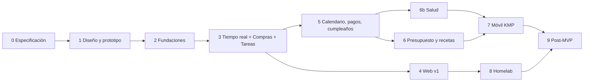

# 08 · Roadmap

Primero diseño, prototipo y documentación; después se construye. Cada fase termina en algo usable. Las duraciones son estimadas para un desarrollador con apoyo de IA.

| Fase | Contenido | Entregable | Estimado |
|------|-----------|------------|----------|
| **0. Especificación** | Visión, requerimientos, arquitectura, modelo de datos, seguridad, despliegue | Esta documentación | ✅ Aprobado por Jose (2026-11-11) |
| **1. Diseño y prototipo** | Identidad visual (logo, paleta, tipografía), flujos, wireframes y pantallas en Figma o Canva para web y móvil, prototipo navegable | Diseño aprobado por Jose + prototipo clicable | ✅ Aprobado ([09](09-diseno-ui.md)) |
| **2. Fundaciones** | Monorepo, CI, Docker Compose local, backend `identity` (registro, verificación, login con correo y Google, JWT + refresh), `family` (crear, invitar, unirse, roles), Flyway, OpenAPI | Se puede crear cuenta, crear familia e invitar por API | ✅ Hecho (PR #3) |
| **3. Tiempo real + Compras + Tareas** | WebSocket STOMP, `change_log`, módulos `shopping` y `chore` | Lista de compras y tareas sincronizadas en vivo (API) | ✅ Hecho (PR #4) |
| **4. Web (Angular) v1** | Login, onboarding de familia, inicio, compras, tareas | Primera versión usable en navegador | 🔄 En revisión ([web](../web/README.md)) |
| **5. Calendario, pagos y cumpleaños** | `calendar` con RRULE, `payment`, `celebration`, recordatorios programados, notificaciones web | Calendario familiar unificado con recordatorios | 3 semanas |
| **6. Presupuesto y recetas** | `budget`, `transaction`, `recipe`, enviar ingredientes a compras, pagos que generan gastos | Todos los módulos del MVP en web | 3 semanas |
| **6b. Salud y medicamentos** | `health`: condiciones, medicamentos, horarios, generación de tomas, recordatorios push con acciones, aviso a un adulto, existencias que alimentan Compras, cifrado de columnas | Módulo de Salud en web y API | 2-3 semanas |
| **7. Móvil (KMP)** | Compose Multiplatform, login con Google, sincronización offline con SQLDelight, push FCM / APNs, alarmas locales de medicamentos con acciones «Tomada / Posponer / Omitir» | App Android (APK) e iOS (TestFlight) | 5-6 semanas |
| **8. Despliegue homelab** | Compose de producción, Caddy / Cloudflare Tunnel, backups, monitoreo, CI/CD a GHCR | Famy en producción en el homelab, usada por la familia | 1 semana (puede adelantarse desde la fase 4) |
| **9. Post-MVP** | Webhooks salientes, planificador de comidas, varias familias por usuario, widgets, publicación en tiendas | Mejoras continuas | Continuo |

## Orden y dependencias

## Hilos de trabajo propuestos
1. Planificar y documentar Famy (esta documentación).
2. Diseñar UI y prototipo de Famy (Figma / Canva).
3. Construir fundaciones del backend (fase 2).
4. Construir web Angular (fases 4-6).
5. Construir app móvil KMP (fase 7).
6. Desplegar en homelab (fase 8).

## Decisiones (aprobadas por Jose el 2026-11-11)
| # | Pregunta | Decisión |
|---|----------|----------|
| P-1 | ¿Herramienta de diseño? | Lienzo de diseño con prototipo navegable (ver [09](09-diseno-ui.md)); Figma solo si se necesita handoff adicional |
| P-2 | ¿Dominio para el homelab y cómo exponerlo? | Subdominio propio + Cloudflare Tunnel |
| P-3 | ¿Moneda por defecto? | USD por defecto; cada usuario la elige en Configuración (y la familia tiene la suya para el presupuesto compartido) |
| P-4 | ¿Los hijos ven presupuesto y pagos? | No por defecto, configurable |
| P-5 | ¿Unirse requiere aprobación del admin? | Sí para código, no para invitación por correo |
| P-6 | ¿Gradle o Maven para el backend? | Gradle Kotlin DSL (mismo lenguaje que móvil) |
| P-7 | ¿Cuenta de Apple Developer para iOS? | Android primero; iOS por TestFlight cuando haya cuenta (USD 99/año) |
| P-8 | ¿Proveedor de correo (SMTP)? | Resend o Brevo (plan gratuito) |
